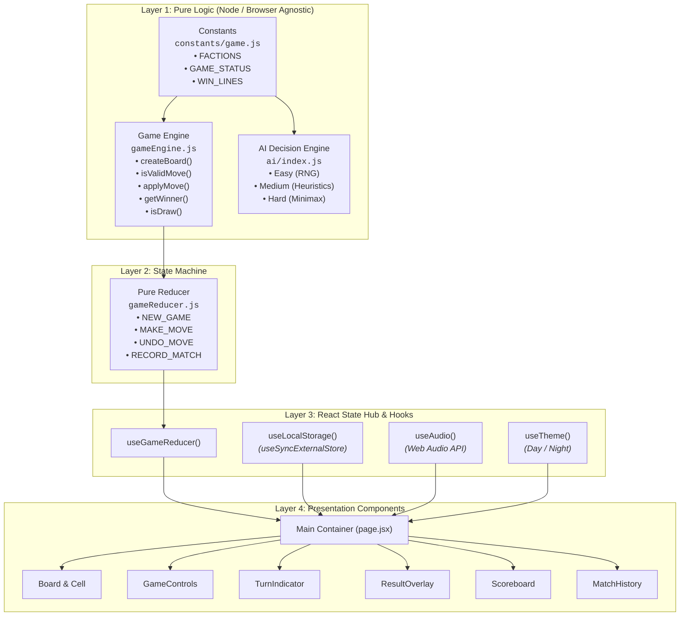

# Architecture Guide — Garden Clash

This document details the architectural design, state management, and separation of concerns powering **Garden Clash**.

---

## 1. Architectural Principles

Garden Clash adheres to five core engineering principles:

1. **Strict Separation of Concerns**: Business logic is completely independent of the presentation layer. The game engine (`gameEngine.js`) contains zero imports from React, Next.js, or DOM APIs.
2. **Deterministic, Side-Effect-Free Reducer**: The game state transitions purely via `(state, action) => newState`. Side effects (such as audio playback, localStorage persistence, or asynchronous AI delays) are never performed inside the reducer.
3. **Pure Function AI Core**: AI strategies operate as pure functions `(board, aiFaction) => cellIndex`. This allows exhaustive testing without DOM or component mocks.
4. **Hydration & SSR Safety**: All browser storage interactions use React 19's native `useSyncExternalStore` hook, eliminating hydration mismatches and cascading re-renders.
5. **Zero-Dependency Procedural Audio**: Sound synthesis relies exclusively on the browser's native Web Audio API, removing external asset dependencies and bandwidth overhead.

---

## 2. System Architecture & Data Flow



---

## 3. Central Game State Shape

The single source of truth for match progress is encapsulated in the reducer state:

```javascript
{
  // 9-element array: null | 'PLANT' | 'ZOMBIE'
  board: [null, null, null, null, null, null, null, null, null],

  // Active turn: 'PLANT' | 'ZOMBIE'
  currentFaction: 'PLANT',

  // Lifecycle status: 'IDLE' | 'PLAYING' | 'PLANT_WINS' | 'ZOMBIE_WINS' | 'DRAW'
  gameStatus: 'IDLE',

  // Active game mode: 'PVP' | 'PVE'
  gameMode: 'PVP',

  // AI level (PvE only): 'EASY' | 'MEDIUM' | 'HARD'
  aiDifficulty: 'EASY',

  // Human player faction in PvE: 'PLANT' | 'ZOMBIE'
  humanFaction: 'PLANT',

  // Ordered move list: Array<{ cellIndex: number, faction: string }>
  moveHistory: [],

  // Unique match session ID (e.g., 'match_initial' or timestamp on start)
  matchId: 'match_initial',

  // Boolean flag preventing duplicate scoreboard recording
  matchRecorded: false,

  // Winning cell indices for highlighting: [number, number, number] | null
  winningLine: null,
}
```

---

## 4. State Action Lifecycles

| Action Type | Payload | State Transformation |
|---|---|---|
| `NEW_GAME` | `{ gameMode?, aiDifficulty?, humanFaction?, matchId? }` | Resets board to 9 nulls, clears history, sets status to `IDLE`, resets `matchRecorded: false`. Preserves mode and settings. |
| `MAKE_MOVE` | `{ cellIndex: number }` | Validates move. If legal and game is active, applies move immutably, appends to `moveHistory`, detects win/draw, updates `winningLine`, and toggles `currentFaction`. |
| `UNDO_MOVE` | — | **PvP**: Pops 1 move.<br/>**PvE**: Atomically pops both the AI response and human move (2 moves). Reconstructs board state, recalculates `gameStatus`, and reopens `matchRecorded`. |
| `RECORD_MATCH` | — | Marks `matchRecorded: true` to prevent double-counting. |
| `SET_GAME_MODE` | `{ gameMode: 'PVP' \| 'PVE' }` | Updates active mode. |
| `SET_AI_DIFFICULTY`| `{ aiDifficulty: 'EASY' \| 'MEDIUM' \| 'HARD' }` | Updates AI intelligence level. |
| `SET_HUMAN_FACTION` | `{ humanFaction: 'PLANT' \| 'ZOMBIE' }` | Sets player faction. |

---

## 5. Persistence Strategy (`useSyncExternalStore`)

Next.js App Router renders pages on the server before hydrating on the client. Direct `localStorage` reads during SSR cause hydration mismatches, while naive `useEffect` reads trigger cascading renders.

To solve this, Garden Clash utilizes React 19's **`useSyncExternalStore`**:

```javascript
// src/hooks/useLocalStorage.js
export function useLocalStorage(key, initialValue) {
  const subscribe = useCallback((callback) => {
    window.addEventListener('storage', callback);
    window.addEventListener('local-storage-update', callback);
    return () => {
      window.removeEventListener('storage', callback);
      window.removeEventListener('local-storage-update', callback);
    };
  }, []);

  const getSnapshot = useCallback(() => {
    // Reads cached parsed JSON from window.localStorage
  }, [key]);

  const getServerSnapshot = useCallback(() => initialValue, [initialValue]);

  return [useSyncExternalStore(subscribe, getSnapshot, getServerSnapshot), setValue];
}
```

### Storage Schema & Versioning
All keys are prefixed and versioned to allow future backward-compatible migrations:
- `garden_clash_scores_v1`: `{ plantWins: number, zombieWins: number, draws: number }`
- `garden_clash_history_v1`: `Array<{ id, winner, mode, difficulty, timestamp }>` (pruned to 50 items)
- `garden_clash_theme_v1`: `'day' | 'night'`
- `garden_clash_sound_v1`: `boolean`

---

## 6. Procedural Audio Engine

Instead of bundling static audio files (which add network requests and potential latency), Garden Clash implements an audio synthesizer in [`audioService.js`](file:///c:/test/Tic-Tac-Toe/src/lib/audio/audioService.js):

- **Plant Placement**: Triangle oscillator gliding from 320 Hz to 780 Hz over 120ms with exponential gain decay.
- **Zombie Placement**: Sawtooth oscillator descending from 220 Hz to 80 Hz with gain clipping.
- **Victory Fanfare**: Sequential square wave arpeggio (C5: 523.25 Hz, E5: 659.25 Hz, G5: 783.99 Hz, C6: 1046.5 Hz).
- **Stalemate**: Dual sawtooth buzz tones at 220 Hz and 160 Hz.
- **Undo**: Sine oscillator pitch sweep down from 600 Hz to 150 Hz.

Autoplay restrictions are handled by checking `ctx.state === 'suspended'` and calling `ctx.resume()` upon the first user interaction.
