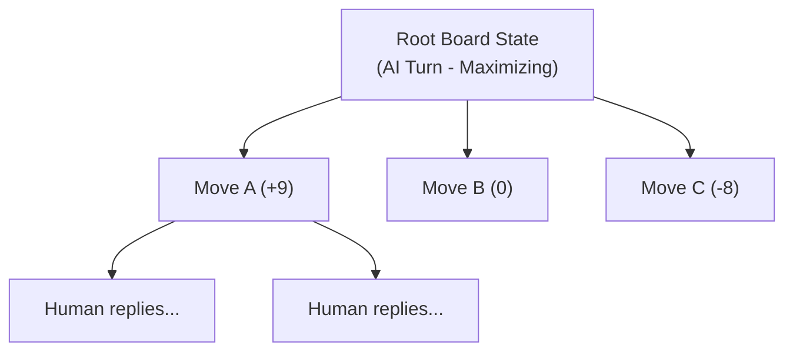

# Game Logic & AI Guide — Garden Clash

This document explains the mathematical models, decision algorithms, and rule enforcement logic in **Garden Clash**.

---

## 1. Board Representation

The 3×3 garden lawn is modeled as a flat 9-element array where each cell index maps to a grid coordinate:

```
 Grid Indices           Coordinates (Row, Col)
  0 | 1 | 2               (0,0) | (0,1) | (0,2)
 -----------             -----------------------
  3 | 4 | 5               (1,0) | (1,1) | (1,2)
 -----------             -----------------------
  6 | 7 | 8               (2,0) | (2,1) | (2,2)
```

Values stored at each index:
- `null`: Available / empty cell
- `'PLANT'`: Occupied by the Plant faction
- `'ZOMBIE'`: Occupied by the Zombie faction

---

## 2. Victory & Draw Conditions

### Winning Lines
There are exactly 8 possible winning lines on a 3×3 grid:

```javascript
export const WIN_LINES = [
  // 3 Horizontal Rows
  [0, 1, 2],
  [3, 4, 5],
  [6, 7, 8],
  // 3 Vertical Columns
  [0, 3, 6],
  [1, 4, 7],
  [2, 5, 8],
  // 2 Diagonals
  [0, 4, 8],
  [2, 4, 6],
];
```

The function `getWinner(board)` iterates through these 8 combinations:
```javascript
export function getWinner(board) {
  for (const [a, b, c] of WIN_LINES) {
    if (board[a] && board[a] === board[b] && board[a] === board[c]) {
      return { faction: board[a], line: [a, b, c] };
    }
  }
  return null;
}
```

### Draw Detection
A draw occurs when two conditions are simultaneously met:
1. `getWinner(board) === null` (No player has formed a line).
2. `board.every(cell => cell !== null)` (All 9 cells are occupied).

---

## 3. Artificial Intelligence (AI) Engines

Garden Clash provides three distinct AI opponents, located in `src/lib/game/ai/`:

### A. Easy AI (`easy.js`)
- **Strategy**: Completely random selection from the list of unoccupied cells (`getAvailableMoves(board)`).
- **Behavior**: May overlook immediate winning opportunities and fails to block obvious opponent threats. Ideal for casual or beginner players.
- **Implementation**:
  ```javascript
  export function getEasyMove(board, randomFn = Math.random) {
    const available = getAvailableMoves(board);
    if (available.length === 0) return null;
    return available[Math.floor(randomFn() * available.length)];
  }
  ```

---

### B. Medium AI (`medium.js`)
- **Strategy**: Tactical rule-based heuristics executed in strict priority order.
- **Priority Hierarchy**:
  1. **Win immediately**: If the AI can win on this move, take that cell.
  2. **Block opponent win**: If the opponent threatens to win on their next turn, take that cell.
  3. **Control the center**: Cell `4` controls 4 winning vectors (row 1, col 1, both diagonals). Take center if available.
  4. **Corner play**: Cells `0, 2, 6, 8` each control 3 winning vectors. Pick a corner if available.
  5. **Edge play**: Cells `1, 3, 5, 7` each control 2 winning vectors. Pick any remaining edge.
- **Behavior**: Competent opponent that never misses an obvious 1-move win or block, but can be defeated with advanced fork setups.

---

### C. Hard AI — The Minimax Algorithm (`hard.js`)
- **Strategy**: Mathematically optimal game-tree traversal using the **Minimax** algorithm.
- **Behavior**: **Unbeatable**. Against an optimal player, it guarantees a draw. Against any suboptimal move, it capitalizes to win.

#### The Minimax Concept
Minimax simulates every possible continuation of the match from the current position.
- **Maximizer (AI)** seeks the move that yields the maximum possible score.
- **Minimizer (Opponent)** seeks the move that minimizes the AI's score.



#### Depth-Penalized Evaluation
Standard Minimax scores terminal states as `+10` (win), `-10` (loss), or `0` (draw). However, without factoring depth, the AI would treat a win in 1 move identically to a win in 5 moves.

Garden Clash incorporates **depth penalties**:
- **AI Victory**: `+10 - depth` (Wins faster = higher score).
- **Human Victory**: `depth - 10` (Delays losses as long as possible = less negative score).
- **Draw**: `0`.

```javascript
function minimax(board, depth, isMaximizing, aiFaction, opponentFaction) {
  const winner = getWinner(board);
  if (winner) {
    return winner.faction === aiFaction ? 10 - depth : depth - 10;
  }
  if (isDraw(board) || getAvailableMoves(board).length === 0) {
    return 0;
  }

  if (isMaximizing) {
    let maxEval = -Infinity;
    for (const move of getAvailableMoves(board)) {
      const next = applyMove(board, move, aiFaction);
      maxEval = Math.max(maxEval, minimax(next, depth + 1, false, aiFaction, opponentFaction));
    }
    return maxEval;
  } else {
    let minEval = Infinity;
    for (const move of getAvailableMoves(board)) {
      const next = applyMove(board, move, opponentFaction);
      minEval = Math.min(minEval, minimax(next, depth + 1, true, aiFaction, opponentFaction));
    }
    return minEval;
  }
}
```

---

## 4. Mode-Aware Smart Undo Algorithm

Undoing a turn in an AI-driven game requires special consideration:

- **In PvP (Player vs. Player)**:
  Players alternate turns on the same device. Clicking "Undo" pops **1 move** from `moveHistory`, returning the board to the previous player.
- **In PvE (Player vs. Computer)**:
  If a human makes a move, the AI immediately responds. If the player clicks "Undo", popping only 1 move would leave the human facing the board immediately after their own move!
  Therefore, the reducer recognizes `gameMode === 'PVE'` and performs an **atomic 2-move rollback**:
  ```javascript
  let movesToUndo = 1;
  if (state.gameMode === GAME_MODES.PVE) {
    const lastMove = state.moveHistory[state.moveHistory.length - 1];
    const lastMoveWasAI = lastMove.faction !== state.humanFaction;

    // If AI already responded, roll back both moves together
    if (lastMoveWasAI && state.moveHistory.length >= 2) {
      movesToUndo = 2;
    }
  }
  ```
- **Reopening Recorded Matches**: If a player undoes from a finished match (e.g. they lost and want to try another move), the reducer automatically resets `matchRecorded: false` and clears `winningLine`, allowing fluid replay experimentation.
